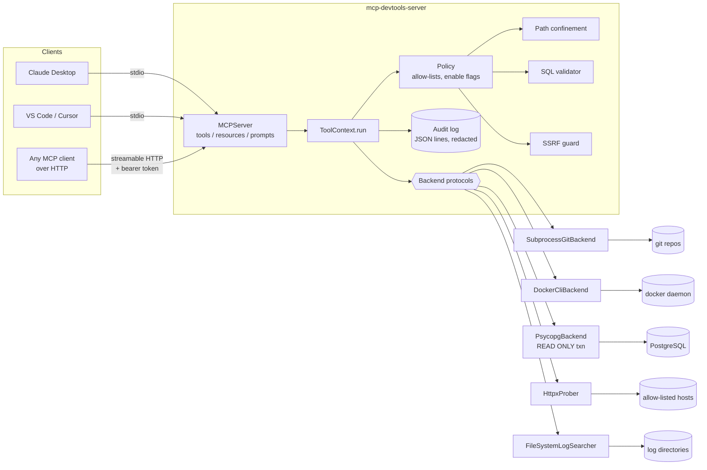

# mcp-devtools-server

**A Model Context Protocol server that lets AI clients read your git history, containers, Postgres, HTTP endpoints and logs, with every access going through allow-lists and an audit log.**

[](https://github.com/alexgeorghiou/mcp-devtools-server/actions/workflows/ci.yml)
[](LICENSE)


MCP clients such as Claude Desktop, VS Code and Cursor are most useful when they can look at
the systems you are debugging. The risk is that a tool which can "run git" or "query the
database" ends up able to do anything. This server takes the opposite approach. Each tool is
read-only and works on named aliases set by the operator, so it never sees raw paths or DSNs.
Every argument is validated before a subprocess, socket or connection is opened, and every
call is written to a JSON-lines audit trail with secrets redacted.

---

## Features

| Family | Tools | Guard rails |
| --- | --- | --- |
| **Git** | `git_log`, `git_show`, `git_diff`, `git_blame`, `git_status`, `git_list_repos` | Repo allow-list. Revisions are validated so they can't be read as options. Paths are confined to the repo and passed after `--`. External diff, textconv, fsmonitor and pager are disabled. Output size and run time are capped. |
| **Docker** | `docker_ps`, `docker_logs`, `docker_inspect` | Container name/pattern allow-list. Only `ps`/`logs`/`inspect` are ever invoked. Secret-looking env vars are masked in the inspect summary. Log lines are redacted. |
| **Postgres** | `pg_query`, `pg_explain`, `pg_list_tables` | DSN alias allow-list. A lexical SQL validator allows a single SELECT/WITH/VALUES/TABLE/SHOW/EXPLAIN and blocks DML, DDL and dangerous functions. Queries run in `SET TRANSACTION READ ONLY` with `statement_timeout`/`lock_timeout` and are always rolled back. Rows are capped and streamed through a server-side cursor. |
| **HTTP** | `http_probe` | Host and port allow-lists. SSRF guard blocks loopback, RFC 1918, CGNAT, link-local/metadata, multicast and IPv4-mapped forms. The peer address is re-checked after connecting. Every redirect hop is re-validated. Proxies from the environment are ignored. |
| **Logs** | `logs_search`, `logs_list_files` | Directory allow-list with path-traversal and symlink-escape protection. Supports regex or substring search with context lines. Results are capped and the search has a time budget. Only the tail of huge files is scanned. Rotated `.gz` files are read transparently. |

**Resources**

- `devtools://config`: the effective configuration, with DSNs reduced to alias names.
- `devtools://audit/tail`: the most recent audit entries.
- `repo://{repo}/readme` and `repo://{repo}/files/{+path}`: files of an allow-listed repo at `HEAD`.

**Prompts**

- `review_recent_commits`
- `diagnose_failing_container`
- `explain_slow_query`

Each prompt is a short runbook that steers the model toward the right sequence of tool calls.

**Operations**

- Per-family enable/disable switches.
- YAML or TOML config with `${ENV}` interpolation.
- **stdio** and **streamable HTTP** transports. HTTP supports an optional bearer token.
- Multi-stage Docker image with a compose playground that includes a sample Postgres database.

## Architecture



A tool call goes through these steps:

1. The MCP SDK validates the arguments against the generated JSON schema.
2. `ToolContext.run` opens an audit record.
3. The policy resolves the alias and refuses anything that is not allow-listed.
4. The family-specific guard (paths, SQL or SSRF) runs.
5. The backend does the work behind a `Protocol`.
6. The result is returned as structured content.

Known failures surface to the client as error results with a stable code such as
`[denied]`, `[invalid]`, `[disabled]` or `[backend_error]`.

## Quickstart

```bash
git clone https://github.com/alexgeorghiou/mcp-devtools-server.git
cd mcp-devtools-server
python -m venv .venv && source .venv/bin/activate      # Windows: .venv\Scripts\activate
pip install -e ".[dev]"

cp examples/devtools.example.yaml devtools.local.yaml  # edit the allow-lists
mcp-devtools check-config -c devtools.local.yaml       # prints the effective, redacted config
mcp-devtools serve -c devtools.local.yaml              # stdio (what desktop clients spawn)
```

Useful extras:

```bash
mcp-devtools validate-sql "WITH x AS (DELETE FROM t RETURNING 1) SELECT * FROM x"
# rejected: keyword DELETE is not allowed in read-only queries

MCP_DEVTOOLS_HTTP_TOKEN=change-me mcp-devtools serve -c devtools.local.yaml -t http --port 8765
# streamable HTTP endpoint: http://127.0.0.1:8765/mcp
```

### Docker playground

```bash
docker compose up --build
```

This starts the server on `http://localhost:8765/mcp` with bearer token `change-me`. It also
starts a sample *lending library* Postgres with a SELECT-only `devtools_reader` role and an
index that is deliberately missing, so `explain_slow_query` has something to find. The
repository itself is mounted as the `devtools` repo and `examples/logs` is mounted as the
`sample` log directory.

## Client configuration

### Claude Desktop (`claude_desktop_config.json`)

```json
{
  "mcpServers": {
    "devtools": {
      "command": "/path/to/mcp-devtools-server/.venv/bin/mcp-devtools",
      "args": ["serve", "--config", "/path/to/devtools.local.yaml"],
      "env": {
        "DEVTOOLS_PG_PASSWORD": "reader-password",
        "MCP_DEVTOOLS_DISABLE": "docker"
      }
    }
  }
}
```

On Windows, use `C:\\path\\to\\mcp-devtools-server\\.venv\\Scripts\\mcp-devtools.exe`.

### VS Code (`.vscode/mcp.json`)

```json
{
  "servers": {
    "devtools": {
      "type": "stdio",
      "command": "${workspaceFolder}/.venv/bin/mcp-devtools",
      "args": ["serve", "--config", "${workspaceFolder}/devtools.local.yaml"]
    }
  }
}
```

### Cursor (`~/.cursor/mcp.json` or `.cursor/mcp.json`)

```json
{
  "mcpServers": {
    "devtools": {
      "command": "mcp-devtools",
      "args": ["serve", "--config", "/path/to/devtools.local.yaml"]
    }
  }
}
```

### Streamable HTTP (shared or containerised server)

```json
{
  "servers": {
    "devtools-http": {
      "type": "http",
      "url": "http://localhost:8765/mcp",
      "headers": { "Authorization": "Bearer change-me" }
    }
  }
}
```

From Python, using the SDK's client:

```python
import httpx
from mcp.client import Client
from mcp.client.streamable_http import streamable_http_client

async with httpx.AsyncClient(headers={"Authorization": "Bearer change-me"}) as http:
    async with Client(streamable_http_client("http://localhost:8765/mcp", http_client=http)) as c:
        result = await c.call_tool("git_log", {"repo": "devtools", "max_count": 5})
```

## Configuration

See [`examples/devtools.example.yaml`](examples/devtools.example.yaml) for every option. The key rules are:

- **Empty allow-list means nothing is allowed.** This applies to repos, containers,
  databases, hosts and log directories.
- Relative paths are resolved against the config file's directory.
- `${NAME}` / `${NAME:-default}` pull values from the environment. A missing variable
  without a default fails at startup.

| Environment variable | Purpose |
| --- | --- |
| `MCP_DEVTOOLS_CONFIG` | Config file path (default for `--config`) |
| `MCP_DEVTOOLS_DISABLE` | Comma-separated families to switch off, e.g. `docker,postgres` |
| `MCP_DEVTOOLS_AUDIT_LOG` | Override `server.audit_log` |
| `MCP_DEVTOOLS_HTTP_TOKEN` | Require `Authorization: Bearer <token>` on the HTTP transport |

Example audit line:

```json
{"ts":"2026-03-01T10:02:16.412+00:00","tool":"pg_query","args":{"database":"library","sql":"SELECT ..."},"outcome":"ok","duration_ms":18.7,"error":null}
```

## Project structure

```text
src/mcp_devtools/
├── cli.py              # Typer CLI: serve (stdio|http), check-config, validate-sql
├── server.py           # builds the MCPServer from enabled tool families
├── config.py           # pydantic settings, YAML/TOML loading, env interpolation
├── audit.py            # audit log + JSONL / in-memory sinks
├── http_auth.py        # bearer-token ASGI middleware for streamable HTTP
├── resources.py        # devtools://config, devtools://audit/tail, repo://...
├── prompts.py          # review / diagnose / explain prompt templates
├── security/
│   ├── permissions.py  # allow-list policy
│   ├── paths.py        # path confinement
│   ├── sql_guard.py    # PostgreSQL-aware lexer + read-only validator
│   ├── ssrf.py         # URL, host, port and IP-range checks
│   └── redact.py       # secret masking for logs and audit
├── backends/           # Protocol + real implementation per external system
│   ├── git.py  docker.py  postgres.py  http.py  logs.py
└── tools/              # MCP tool registration + service classes per family
    ├── context.py  git_tools.py  docker_tools.py  db_tools.py  http_tools.py  log_tools.py
tests/                  # fakes, temp git repo fixtures, in-memory MCP session tests
examples/               # example config, compose config, sample DB schema and logs
```

## Testing

```bash
ruff check . && ruff format --check . && mypy && pytest
```

- **Git** tests run against a real temporary repository created in a fixture.
- **Docker, Postgres and HTTP** tests use in-memory fakes of the backend protocols. They also
  use scripted `subprocess.run` / `psycopg.connect` doubles and `httpx.MockTransport`, so no
  daemon, database or network is needed.
- `tests/test_server_session.py` drives the whole server through the SDK's in-memory
  `Client`. It covers tool listing, structured results, error results, resources, resource
  templates, prompts and disabled families.
- `tests/test_postgres_integration.py` runs against a real Postgres when
  `MCP_DEVTOOLS_TEST_PG_DSN` is set. CI does this with a service container. These tests check
  that the *database* refuses writes even if the validator is bypassed, and that the
  statement timeout fires.

## Design decisions and trade-offs

- **Aliases instead of raw paths, DSNs and URLs.** The model never sees a connection string
  and cannot ask for a repo the operator didn't name. The cost is a little configuration up
  front.
- **Two layers for SQL.** The lexical validator gives fast, readable rejections. It
  understands comments, dollar quoting and `E''` strings, and catches side-effecting
  functions such as `pg_terminate_backend` and `dblink`, which a read-only transaction would
  still allow. The database's `READ ONLY` transaction is the real guarantee. Neither replaces
  a SELECT-only role, which the compose setup and docs use.
- **Row caps by fetching, not by rewriting SQL.** Appending `LIMIT` breaks on many valid
  queries. Instead the backend fetches `max_rows + 1` from a server-side cursor, so large
  results are never transferred and truncation is reported accurately.
- **SSRF: resolve, check, connect, check again.** The probe validates every resolved address
  before connecting. Afterwards it validates the socket's actual peer address, which narrows
  DNS-rebinding windows without needing a custom DNS-pinning transport. Proxies are disabled
  because they would hide the real peer.
- **CLI rather than SDKs for git and docker.** Using the binaries means the server honours
  the operator's existing contexts, credentials and git config and adds no heavy dependency.
  The price is subprocess hardening, so arguments use argv lists, attached option values,
  `--` separators and a safe `-c` config set.
- **Errors are results, not crashes.** Known failures carry a stable code so clients (and
  models) can tell "denied" from "broken". Connection failures in `http_probe` are returned
  as data because "the site is down" is a valid answer.
- **Sync backends in worker threads.** The MCP SDK runs sync tools in a thread pool, which
  keeps backends simple and testable. An async rewrite would matter only for very high
  concurrency over HTTP.
- **Static bearer token for HTTP.** It is enough for a local or sidecar deployment. Anything
  multi-user should sit behind the SDK's OAuth support or an authenticating proxy (see
  roadmap).

## Roadmap

- [ ] OAuth 2.1 resource-server mode for streamable HTTP via the SDK's `TokenVerifier`
- [ ] Per-client policies (different allow-lists per token)
- [ ] Kubernetes family (`kubectl get/describe/logs`) behind the same backend protocol
- [ ] Docker Engine API backend over a read-only socket proxy
- [ ] `git_grep` and `git_log` pagination with cursors
- [ ] OpenTelemetry spans alongside the audit log
- [ ] Rate limiting per tool family

## License

[MIT](LICENSE) © 2026 Alex Georghiou
